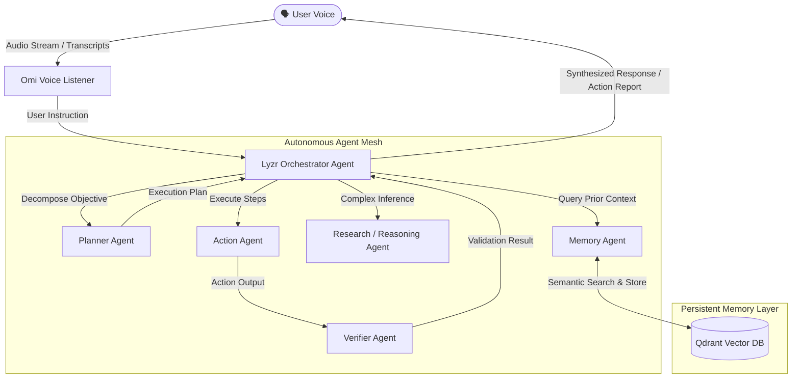

# MemoryMesh

> **Voice-First Autonomous Multi-Agent System**  
> *Hackathon: "Stop Prompting. Code Solo Agents — The Dawn of the Autonomous AI Builder"*

---

## 🌟 Overview

**MemoryMesh** is an autonomous multi-agent system driven by voice. A user speaks a task through **Omi**, which is received and interpreted by an orchestrator powered by **Lyzr**. The orchestrator coordinates specialized agents that can query persistent semantic vector memory in **Qdrant**, execute steps, verify results, and write new contextual knowledge back into Qdrant for continuous recall.

### Core Technologies
- **Omi**: Real-time voice capture and audio streaming.
- **Qdrant**: Persistent vector memory and semantic retrieval engine.
- **Lyzr**: Multi-agent orchestration, agent role definitions, and structured reasoning.
- **FastAPI**: Asynchronous high-performance Python backend.

---

## 🏗️ Architecture



---

## 🤖 Planned Agent Roles

1. **Orchestrator Agent**: Central coordinator powered by Lyzr that understands tasks, delegates subtasks, and synthesizes answers.
2. **Planner Agent**: Breaks high-level user tasks into sequential and parallel execution steps.
3. **Memory Agent**: Performs semantic search and persistent storage of conversation context and domain memory in Qdrant.
4. **Research/Reasoning Agent**: Conducts analytical reasoning and information synthesis.
5. **Action Agent**: Executes external tools, API integrations, and practical operations.
6. **Verifier Agent**: Validates output against the original user prompt for accuracy, alignment, and completion.

---

## 📁 Project Structure

```
memorymesh/
├── backend/
│   ├── __init__.py
│   ├── main.py              # FastAPI application entry point
│   ├── config.py            # Environment & app configuration
│   ├── agents/              # Multi-agent role modules
│   │   ├── __init__.py
│   │   ├── orchestrator.py
│   │   ├── planner.py
│   │   ├── memory.py        # MemoryAgent integration with Qdrant
│   │   ├── research.py
│   │   ├── action.py
│   │   └── verifier.py
│   ├── memory/              # Vector database integration
│   │   ├── __init__.py
│   │   ├── models.py        # Pydantic memory request/response schemas
│   │   ├── qdrant_client.py # QdrantMemoryService vector storage & search
│   │   └── router.py        # Memory REST API endpoints
│   ├── omi/                 # Voice listener integration
│   │   ├── __init__.py
│   │   └── listener.py
│   └── services/            # Shared LLM & utility services
│       ├── __init__.py
│       └── llm.py
├── tests/
│   ├── __init__.py
│   ├── test_health.py       # Health check test suite
│   ├── test_memory_api.py   # Memory REST API test suite
│   └── test_qdrant_service.py # Qdrant service & MemoryAgent unit tests
├── .env.example             # Template for required environment variables
├── .gitignore               # Git ignore rules for Python & environments
├── requirements.txt         # Project dependencies
└── README.md                # Project documentation
```

---

## 🚀 Getting Started

### 1. Prerequisites
- **Python 3.11+** installed
- Git installed
- Qdrant cluster endpoint & API key (Qdrant Cloud or local Docker instance)

### 2. Environment Setup

Clone the repository and navigate into the workspace:
```bash
git clone https://github.com/your-username/memorymesh.git
cd memorymesh
```

Create and activate a virtual environment:
- **On Windows (PowerShell):**
  ```powershell
  python -m venv .venv
  .\.venv\Scripts\Activate.ps1
  ```
- **On Linux / macOS:**
  ```bash
  python3 -m venv .venv
  source .venv/bin/activate
  ```

### 3. Install Dependencies
```bash
pip install -r requirements.txt
```

### 4. Configure Environment Variables
Copy the example environment file:
- **On Windows (PowerShell):**
  ```powershell
  Copy-Item .env.example .env
  ```
- **On Linux / macOS:**
  ```bash
  cp .env.example .env
  ```

Configure your credentials in `.env`:
```env
# Qdrant Vector Memory Configuration
QDRANT_URL=https://your-qdrant-cluster-url:6333
QDRANT_API_KEY=your_qdrant_api_key_here
QDRANT_COLLECTION_NAME=memorymesh_memories

# Lyzr Multi-Agent Orchestration & LLM
LYZR_API_KEY=your_lyzr_api_key_here
LYZR_AGENT_ID=your_lyzr_agent_id_here
LYZR_API_URL=https://agent-prod.studio.lyzr.ai/v3/inference/chat/
```

### 5. Run the Application
Start the FastAPI server:
```bash
uvicorn backend.main:app --reload --host 0.0.0.0 --port 8000
```
The application and interfaces are available at:
- **Frontend AI Dashboard:** `http://localhost:8000/`
- **Swagger UI:** `http://localhost:8000/docs`
- **Redoc:** `http://localhost:8000/redoc`

#### Optional: Standalone Frontend Server
If you prefer running the frontend on a decoupled port:
```bash
python -m http.server 3000 -d frontend
```
Then visit `http://localhost:3000` (the frontend connects to `http://127.0.0.1:8000` with full CORS support and a runtime URL switcher).

### 6. Verify Endpoints
- **Application Health:**
  ```bash
  curl http://localhost:8000/health
  ```
- **Qdrant Vector DB Health:**
  ```bash
  curl http://localhost:8000/health/qdrant
  ```
- **Lyzr Agent Studio Health:**
  ```bash
  curl http://localhost:8000/health/lyzr
  ```
- **Store Memory Embedding:**
  ```bash
  curl -X POST http://localhost:8000/api/memory/store \
    -H "Content-Type: application/json" \
    -d '{"content": "User prefers morning meetings", "vector": [0.1, 0.2, 0.3, 0.4], "metadata": {"source": "omi_voice"}}'
  ```
- **Semantic Memory Search:**
  ```bash
  curl -X POST http://localhost:8000/api/memory/search \
    -H "Content-Type: application/json" \
    -d '{"vector": [0.1, 0.2, 0.3, 0.4], "limit": 3}'
  ```

### 7. Run Test Suite
```bash
python -m pytest -v
```

---

## 🛡️ Hackathon Submission Checklist

- [x] Phase 1: Clean production-oriented backend foundation
- [x] Phase 2: Qdrant vector memory collection & semantic retrieval implementation
- [x] Phase 3: Lyzr autonomous agent orchestration & multi-agent mesh implementation
- [x] Phase 4: Omi real-time voice input stream & webhook processing
- [ ] Phase 5: End-to-end Voice → Memory → Agent workflow integration & demo video (< 5 mins)
